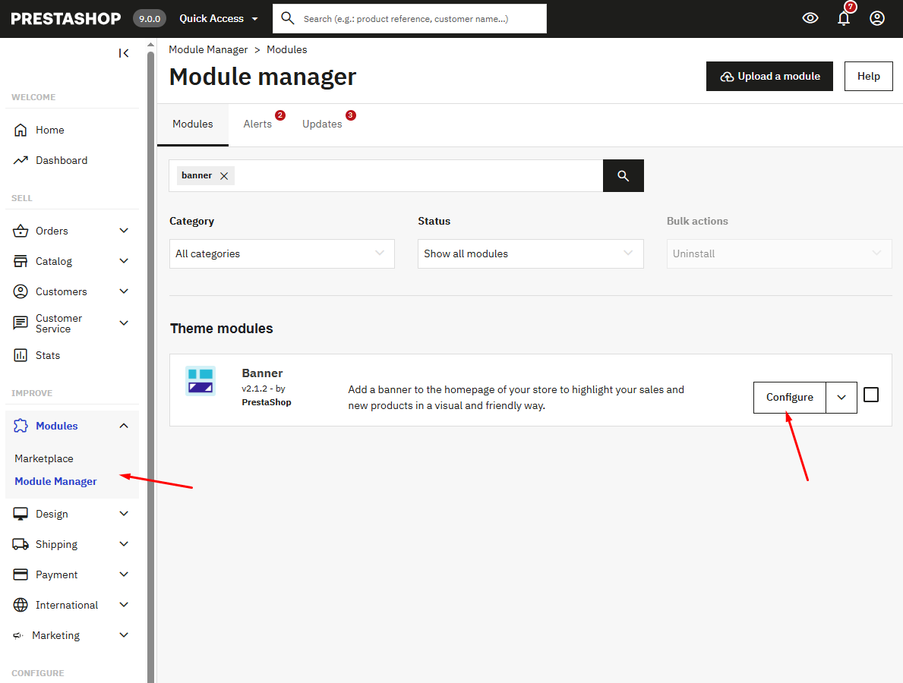

# Banner

In the Configure module of the Banner

<figure><figcaption></figcaption></figure>

Add banner content by clicking on the source code of the banner description section.

<figure><figcaption></figcaption></figure>


```html
<div class="row">
<div class="col-xs-12 col-sm-6 col-md-6 col-lg-12 col-xl-3">
<div class="category_block">
<h4 class="section__label">category</h4>
<h2 class="section__title">Top Summer Cycling Picks.</h2>
<div class="category_list">
<div><a class="item-1" href="#">bladder</a> <a class="item-2" href="#">tshirt</a> <a class="item-3" href="#">gears</a> <a class="item-4" href="#">shoes</a> <a class="item-5" href="#">jacket</a> <a class="item-6" href="#">accessories</a> <a class="item-7" href="#">more</a></div>
</div>
</div>
</div>
<div class="col-xs-12 col-sm-6 col-md-6 col-lg-4 col-xl-3">
<div class="banner__item--wrapper">
<div class="banner__item--image"><a href="#"> </a></div>
<div class="banner__item--text">
<div class="banner__item--heading"><a href="#">hiking</a></div>
</div>
</div>
</div>
<div class="col-xs-12 col-sm-6 col-md-6 col-lg-4 col-xl-3">
<div class="banner__item--wrapper">
<div class="banner__item--image"><a href="#"> </a></div>
<div class="banner__item--text">
<div class="banner__item--heading"><a href="#">Running</a></div>
</div>
</div>
</div>
<div class="col-xs-12 col-sm-6 col-md-6 col-lg-4 col-xl-3">
<div class="banner__item--wrapper">
<div class="banner__item--image"><a href="#"> </a></div>
<div class="banner__item--text">
<div class="banner__item--heading"><a href="#">Cycling</a></div>
</div>
</div>
</div>
</div>
```

