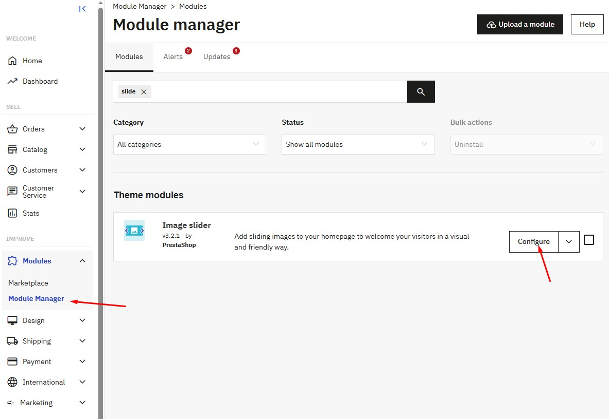
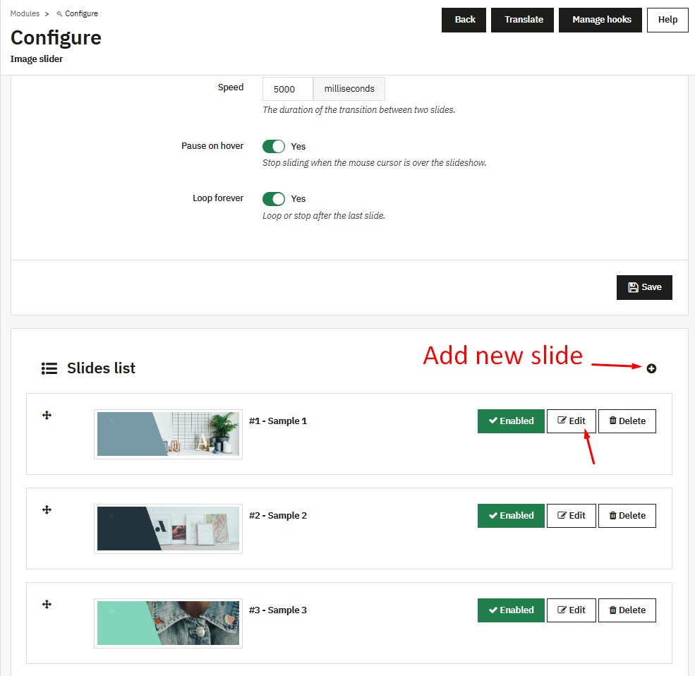
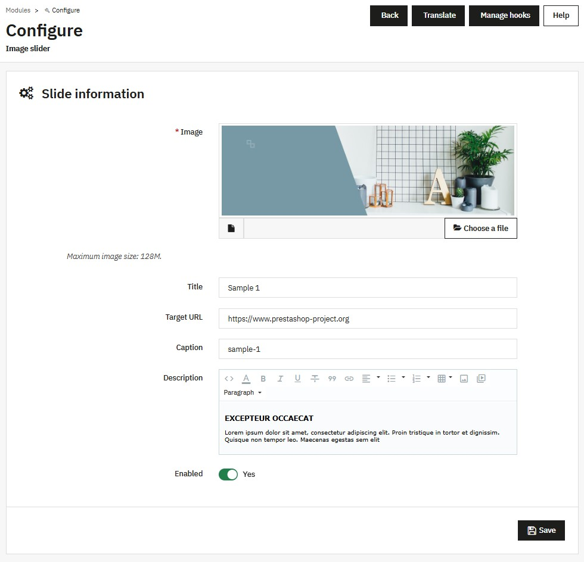

# Slideshow

In the Configure module of the Image slider

<figure><figcaption></figcaption></figure>

Includes full functions to add, delete, edit, and enable/disable slides, as well as configure slide transition time.

<figure><figcaption></figcaption></figure>

Easily edit slide content.

<figure><figcaption></figcaption></figure>
