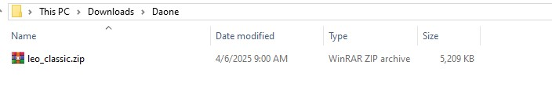
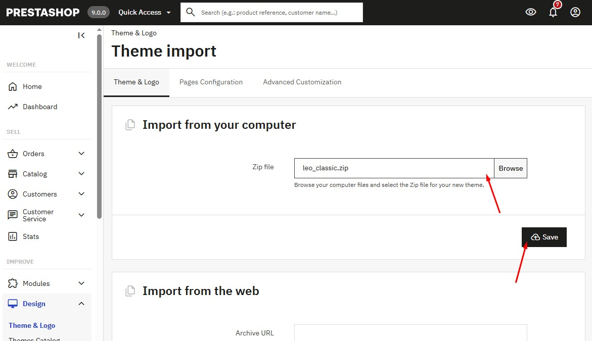
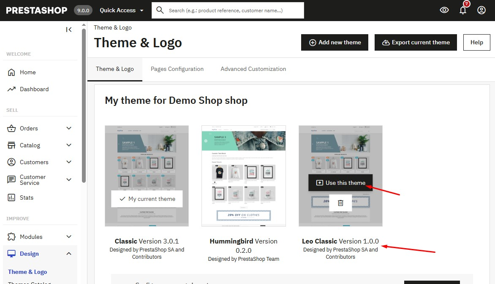

# Install Theme

Download the Daone theme and extract to file downloaded. Then open the folder you have just extracted.

<figure><figcaption></figcaption></figure>

<figure><figcaption></figcaption></figure>

<figure><figcaption></figcaption></figure>

<figure><figcaption></figcaption></figure>
