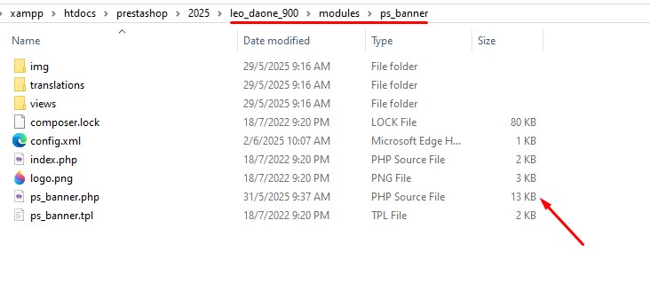

# Update Module

To complete the theme and make editing easier, we need to upgrade some modules.

### 1. Update module ps\_banner

Download and replace the necessary files for the module upgrade.



<figure><figcaption></figcaption></figure>
