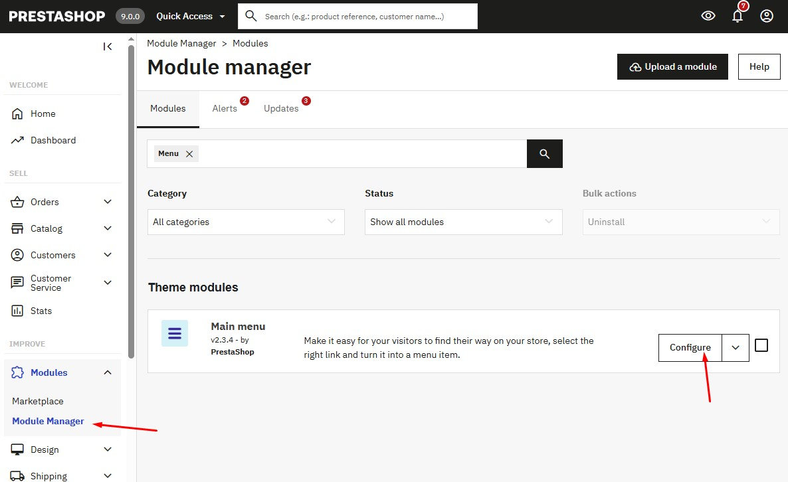
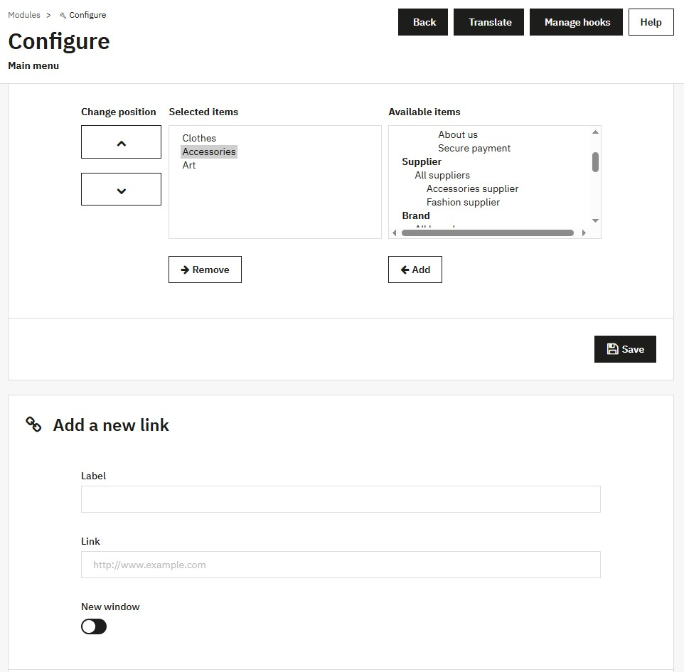

# Menu

In the Configure module of the main menu

<figure><figcaption></figcaption></figure>

The 'Selected items' section contains the menus that will be displayed on the interface. You can change the position of the menus by clicking the up or down buttons in the 'Change position' area. You can choose existing menus from the 'Available items' section or add custom menus in the 'Add a new link' section. After completing the settings, save your changes.

<figure><figcaption></figcaption></figure>
