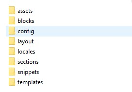

# 4. Cấu trúc thư mục theme trong Shopify

* **Folder assets**: Chứa file CSS và JavaScript.
* **Folder blocks:** Chứa các block tái sử dụng, có schema, dùng bên trong section.
* **Folder config**: Chứa nội dung hiển thị trên trang thiết lập giao diện. (Lưu ý: Không chỉnh sửa file settings\_data.json).
* **Folder layout**: Template chính, hiển thị trong theme.liquid.
* **Folder locales**: Định dạng ngôn ngữ cho theme (các file chính: en.default.json, en.default.schema.json).
* **Folder sections**: Chứa các section có thể thêm hoặc tùy chỉnh theo chủ đề.
* **Folder snippets**: Các đoạn mã có thể sử dụng lại nhiều lần.
* **Folder templates**: Bao gồm các template của giao diện.

